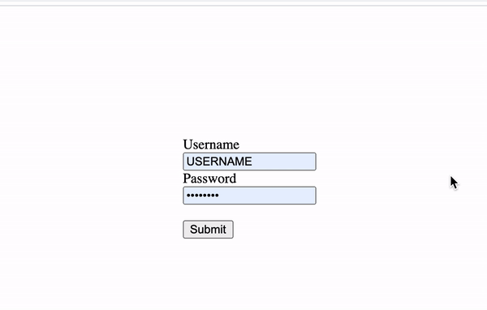
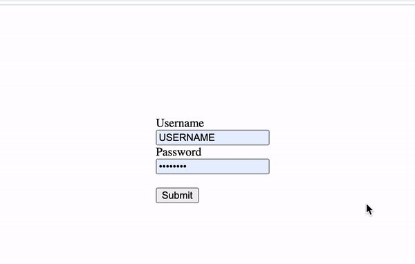

# （翻译）你应该关闭你密码管理器中的自动填充功能

> 原文 [You should turn off autofill in your password manager](https://marektoth.com/blog/password-managers-autofill/)

个人更新：

- 2021.7.31：完成前三节的翻译

---

2021.7.13

---

更新：

- 2021.7.19：为“用户的潜在威胁”这一章节添加了例子，并解释了自动填充的类型
- 2021.7.27：编辑了 Firefox 的禁用自动填充

提醒：

- 这篇文章不是关于手动自动填充（即在 UI 中点击），而主要是关于无需用户交互（或者少量交互——即一次任意地方的点击）即可填充密码的密码管理器。
- XSS 漏洞可以出现在域名中的任何位置，因此登录页面上的 XSS 不是必需的。

---

密码管理器在 IT 安全领域是一个非常流行的话题。我个人也（并只）同意使用密码管理器。毕竟对于人来说记住几十个独特的密码几乎是不可能的。

然而，“自动填充功能应该被禁用”或“应设置成仅当用户请求时填充”这类话题则通常很少被提到。相反，这项功能更经常被描述为能够确保方面和“安全”的有用功能。是的，它确实很方便，但是会丢失安全性。

**大部分的密码管理器都默认开启自动填充功能**，即使它会减少储存的密码的安全。

如果用户使用默认配置或遵循密码管理器的建议，那么**通过鼠标单击，能够从 11 个经过测试的浏览器和密码管理器（总共 16 个）中窃取到登录凭据**。因此即使数据库/密码没有泄露，攻击者也能够获取到你的数据——这些用户密码都是可读且未加密的明文形式。


自动填充可以分为两类：**自动的自动填充**（无需用户交互自动进行密码填充）和**手动的自动填充**（在进行一些用户交互——比如点击密码管理器的 UI 后，自动填充密码）。在文章的后续，自动填充这一术语描述的是自动的自动填充这一类型。

该博文内容包含：

- [（翻译）你应该关闭你密码管理器中的自动填充功能](#翻译你应该关闭你密码管理器中的自动填充功能)
  - [自动填充](#自动填充)
  - [在基于 chromium 的浏览器中的自动填充](#在基于-chromium-的浏览器中的自动填充)
  - [滥用自动填充？跨站脚本（XSS）](#滥用自动填充跨站脚本xss)

## 自动填充

顾名思义，该功能能够确保密码管理器自动填充登录表单。数据只会在已存储了数据的域名预填充。

自动填充的行为取决于很多因素。除了域名之外，协议的使用（http/https）、表单属性以及元素 ID 和名称都会检查。

从安全的角度来看，这项功能能够用于验证用户是否处于钓鱼网站。如果用户正在钓鱼网站，那么数据不会自动填充。用户可能因此注意到异常行为并检查他们所处的域名。

除了“验证”钓鱼网站之外，这更是一种方便的的登录功能，因为用户无需点击任何地方便能够预填充所有的内容。然而，预填充数据存在问题，因为所有的数据都是可读形式（即明文）并且能够被 JavaScript 获取。

## 在基于 chromium 的浏览器中的自动填充

在基于 chromium 的浏览器（除了 Brave）中，自动填充功能的工作方式和 Firefox 或常规密码管理器有些许不同。

在上述浏览器中，数据（看上去）在第一次查看时会自动填充，但事实并非如此。表单中显示的数据并没有真正填写，这些数据只有在用户与网站交互时才会真正填写。

用户交互的类型必须是 isTrusted （即由用户触发），带有比如按键或鼠标点击等事件。mouseover、mousemove 和类似的”更简单“的时间则不会触发完全自动填充。如果在没有事先与网站用户交互的情况下显示输入的内容，那么得到的只有空值。

我创建了一个能够在 5 秒后显示表单内容的值的脚本用于演示：

```html
<form action="/example.html">
  <label for="username">Username</label><br />
  <input type="text" id="username" name="username" /> <br />
  <label for="psw">Password</label><br />
  <input type="password" id="password" name="password" /><br /><br />
  <input type="submit" value="Submit" />
</form>

<script>
  window.setTimeout(function () {
    var username = document.getElementById("username").value;
    var password = document.getElementById("password").value;

    alert(username + ":" + password);
  }, 5000);
</script>
```

你可以从下面的动画中明白在基于 chromium 的浏览器中自动填充是如何工作的：

无点击：



1 次点击：



因此攻击者需要用某种方式诱使用户点击网站上的某处。如果我是攻击者，我可能会使用显示通知或 cookie 对话框。这两种类型的元素都很频繁地显示在网站上，因此受害者可能不会怀疑是可疑活动。

我们的目标不是让用户准确的点击某个地方，只需要进行点击就足够了。在我看来，显示一个让浏览网站的行为感到不舒服、并且需要与网站交互才能删除的元素，这是一种非常有效的从用户获取点击的方式。

## 滥用自动填充？跨站脚本（XSS）

XSS 是最常见的 Web 漏洞。如果网页存在这种类型的漏洞，则可以将 JavaScript 代码注入该页面。然后注入的代码将执行攻击者定义的操作，例如窃取登录凭据。

有几种方法可以使用 XSS 窃取用户登录凭据。有人可能会考虑捕获输入到登录表单的值或更改表单操作值（即发送数据的地址）。那么我有几个问题：

- 如果 XSS 漏洞与登录表单不在同一页面怎么办？
- 如果用户已经登录，导致登录表单不可用怎么办？

答案可能是向用户显示一个全新的登录表单。理想情况下，更改前端使其看起来像是已注销需重新登录。

是的，上述方法可能有效，但使用这种方法，我将不得不依赖受害者重新输入他们的凭据。但是如果用户没有填写新的登录表单呢？

我不喜欢受害者的复杂交互。如果希望用户进行 2 次以上的正常鼠标点击，那就是要求太高并且需要考虑不同的解决方案了。除了其他事项之外，如果我要求用户再次登录（重新输入凭据），此时它主要基于社会工程学的角度（而非技术方面）。

我的解法是滥用密码管理器的自动填充功能。如果知道了 XSS 漏洞，**我会用 JavaScript 创建一个对用户完全隐藏的新登录表单**。密码管理器将检测到此表单的存在，并将数据自动填充进去。所以我们的目标是利用正在使用的密码管理器的错误配置。

<span style="color:green;font-weight:bold;">优点：</span>

- 攻击发生在后台
- 受害者无需或只需要最少的交互（1 次点击）
- **XSS 漏洞在域名中到处都存在**，对于某些密码管理器来说子域名也足够（使用 XSS 漏洞）
- 用户依然可以登录

<span style="color:brown;font-weight:bold;">局限：</span>

- 用户需要在域名下储存密码
- 用户需要在密码管理器中启动自动填充功能
- 密码管理器不能被锁定/注销

**“XSS 虚假登录界面”和“XSS 隐藏登录表单”之间用户交互的区别：**

- XSS 虚假登录界面：点击输入用户名/邮箱，填充用户名/邮箱，点击输入密码，填充密码 = 4 次交互
- XSS 隐藏登录表单：**0~1 次交互（最多一次点击或按键）**
