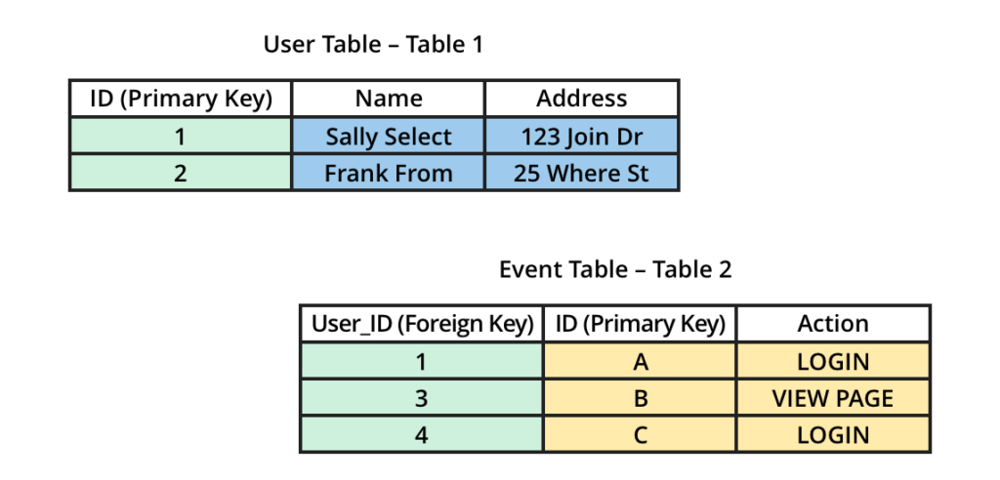
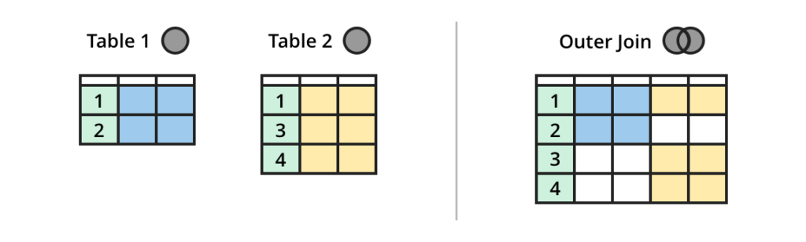
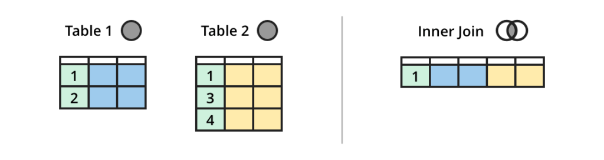
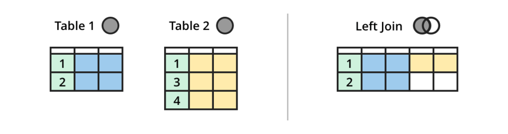
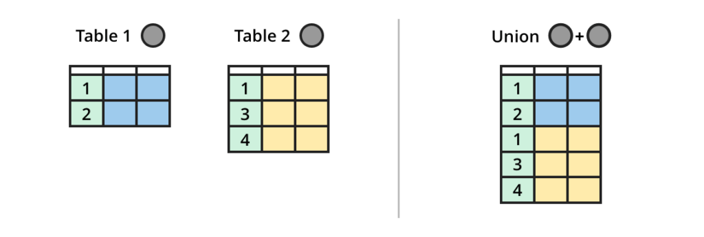
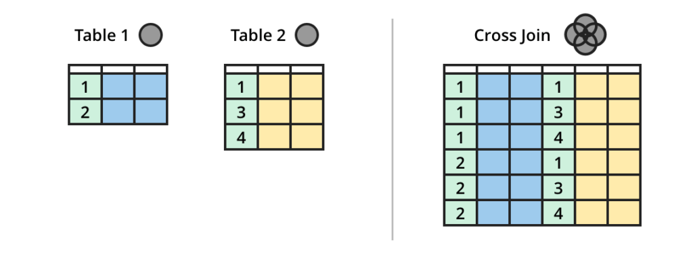
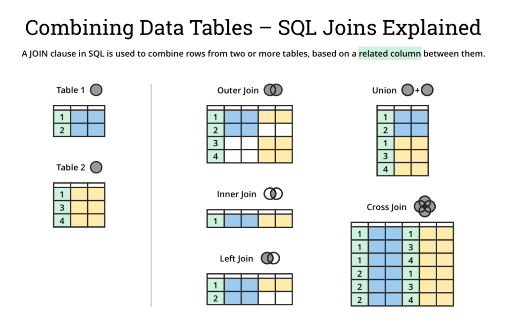

# （翻译）SQL 表格连接的可视化连接

> 原文[SQL Join Types Explained Visually](https://dataschool.com/how-to-teach-people-sql/sql-join-types-explained-visually/)
>
> 使用图形介绍 SQL join 的类型，简明易懂

最后更新时间：2021.8.9

- [（翻译）SQL 表格连接的可视化连接](#翻译sql-表格连接的可视化连接)
  - [主键和外键](#主键和外键)
  - [Join 的种类](#join-的种类)
    - [外连接（Outer Join）](#外连接outer-join)
    - [内连接（Inner Join）](#内连接inner-join)
    - [左连接（Left Join）](#左连接left-join)
    - [联合连接和交叉连接（Union and Cross Join）](#联合连接和交叉连接union-and-cross-join)
  - [摘要小抄](#摘要小抄)

使用 SQL 或 SQL 工具合并两个数据集可以通过 JOIN 指令来完成。JOIN 是查询的 FROM 子句中的一条 SQL 指令，用于确定你所查询的表以及它们应该如何合并。

## 主键和外键

通常在[关系数据库](https://en.wikipedia.org/wiki/Relational_database/)中，数据被组织成由属性（列）和[记录](https://en.wikipedia.org/wiki/Relational_database/)（行）组成的各种表。在每个表中都有一列是**主键(Primary Key)**，该列中每个条目都唯一地代表该表中的一条记录。这通常是 ID（标识符 _identifier_ 的缩写）列。在一个表中，通过共享值与另一个表的主键建立关联的列被称为**外键（Foreign Key）**。外键通常也是以 ID 为标题，但在前面加上被引用表的名称。

外键这个概念在使用 JOIN 将两个或更多的表结合在一起时被应用。在下面的例子中，我们有两个表。用户表（表 1）和事件表（表 2）。我们想把这两个表连接起来，以获得用户数据和他们的事件数据。举一个现实生活中的例子，如果你有来自 [CRM 工具](https://baike.baidu.com/item/crm%E8%BD%AF%E4%BB%B6/7307676)（如 Salesforce）的数据，其中包含付费用户（表 1）和事件分析工具（如 Mixpanel）的数据，后者跟踪所有在你的产品中执行过行动的用户（表 2）。

请注意，在这两个表之间有一个共同的列（维度），以绿色显示，即用户 ID。在用户表中，`ID` 列是用户的 ID，它是该表的主键，而在事件表中，`User_ID` 列是外键，因为该列是指用户表中的 ID 列。我们可以利用这种关系将两个表连接起来，在一个表中得到用户和事件的信息。

## Join 的种类

有三种常见的方式可以将任何两个或更多的表连接在一起。让我们先了解一下：**外连接**、**内连接**和**左连接**。这里有一些通过这些连接方式以及使用上面的用户表和事件表所做的例子。

### 外连接（Outer Join）

假设你想有一个表，包含所有的用户表以及事件表的数据。

你可以使用一个**外连接**来连接这些表。在可能的情况下，外连接将所有表的列合并到一个或多个共同维度上，并包括所有表的所有数据。

想要了解外连接的更多详情请[点这里](https://dataschool.com/how-to-teach-people-sql/full-outer-join-animated/)

### 内连接（Inner Join）

如果你想要一个只包含做过某个动作的用户的表呢？

你可以使用一个**内连接**来连接这些表。在可能的情况下，内联将共同维度上的列（前 N 列）结合起来，并且只包括在共同的 N 列中具有相同值的列的数据。在这个例子中，用户 ID 将是用于内连接的共同维度。

想要了解内连接的更多详情请[点这里](https://dataschool.com/how-to-teach-people-sql/inner-join-animated/)

### 左连接（Left Join）

现在，如果你想有一个包含所有用户数据的表，而且只包含这些用户所做的动作，怎么操作？不在用户表中的其他用户所做的操作是否应该被包括在内？

你可以使用**左连接**来连接这些表。在可能的情况下，左连接结合了共同维度上的列（前 N 列），从第一个表中返回与连续表中的匹配行的所有行。当没有匹配时，在连续的表中的结果是 `NULL`。在这种情况下，我们会把用户表作为左连接的第一个（左表）。

想要了解左连接的更多详情请[点这里](https://dataschool.com/how-to-teach-people-sql/left-right-join-animated/)

### 联合连接和交叉连接（Union and Cross Join）

除了这些常见的连接类型外，还有一些方法会在你的输出表中产生额外的行以及更多的列。比如说**联合连接**和**交叉连接**。这两种连接类型可能不适合我们上面的示例表，但是为了这篇文章，我们仍然可以使用它们来看看这些连接是如何运作的。联合连接将把表叠在一起，产生新的行。

想要了解联合连接的更多详情请[点这里](https://dataschool.com/how-to-teach-people-sql/union-animated/)

举个例子，如果你想通过追加而不是连接来合并两个表。**交叉连接**会产生一个包含你的表的所有可能的行的组合的表。然而这可能会导致巨大的表，应该谨慎使用。

想要了解交叉连接的更多详情请[点这里](https://dataschool.com/how-to-teach-people-sql/union-animated/)

## 摘要小抄

编写——[Tim Miller](https://dataschool.com/people/tim/)

审阅——[Matt David](https://dataschool.com/people/matt/)
